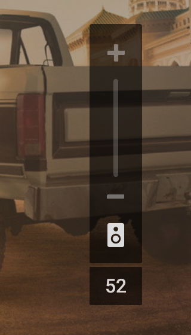

# ARC Volume

Shows the soundbar volume as a number on Android TV when sound goes out over HDMI ARC.

With a soundbar on HDMI ARC, many TVs show only `+` and `-` arrows instead of the volume level.
ARC Volume adds a small box with the current level under the TV's volume panel.



## Features

- Shows the soundbar's own volume level as soon as you press the remote.
- Shows a muted icon when the sound is muted.
- Matches the TCL Google TV volume panel by default; position and size can be changed.
- Works with any step per press: learns it automatically, or you set it.
- Fully usable with the remote. No internet access, no analytics, no ads.

## Requirements

- Android TV or Google TV, Android 14 or newer.
- A soundbar connected over HDMI ARC or eARC with HDMI-CEC control.

Tested on a TCL 55C7K with a Sony HT-S350.

## Installation

1. Download the latest `arc-volume-<version>.apk` from
   [Releases](https://github.com/Domanell/android-tv-arc-volume/releases).
2. Install it on the TV, for example from a USB stick with a file manager, or with Downloader or
   Send Files to TV.
3. Open **ARC Volume** and allow **Display over other apps** when asked.
4. Press Back. The app keeps running in the background.

To update, install the new APK over the old one. Settings are kept.

## Auto-start

Most TVs start ARC Volume by themselves after a restart. Open **Permissions and auto-start** in
the app to see whether it started with the TV. If it did not, the TV blocks auto-start; open the
app once after each restart, or allow auto-start as described below.

### TCL TVs

TCL TVs only let apps start with the TV if **TCL Guard** (also called Safety Guard) allows it.

1. In ARC Volume, open **Permissions and auto-start** and select **Auto-start**.
2. TCL Guard opens on **Permission Shield > Auto Launch**. Turn on ARC Volume.

On some TCL firmware TCL Guard has no Auto Launch tab; the app tells you so. In that case use
[ADB](#tcl-tvs-with-adb). If TCL Guard is disabled on your TV, enable it in **Settings > Apps**.

### TCL TVs with ADB

For TCL TVs without the Auto Launch tab. You need a computer with
[ADB](https://developer.android.com/tools/releases/platform-tools) once.

1. On the TV, turn on **Developer options** (select **Settings > System > About > Android TV OS
   build** seven times), then **Developer options > Wireless debugging**.
2. Pair and connect, then allow auto-start:

   ```sh
   adb pair <tv-ip>:<pairing-port> <code>
   adb connect <tv-ip>:<port>
   adb shell cmd appops set io.github.domanell.arcvolume AUTO_START allow
   ```

3. Restart the TV and check that the number appears without opening the app.

The permission stays after restarts. To undo it, run the same command with `default` instead of
`allow`, or uninstall the app.

## Settings

- **Position and size:** move the box with the arrows and change its size. **Reset to default**
  puts it back under the TCL panel.
- **Volume step:** how many levels the soundbar moves per press. Automatic by default; you can
  set it yourself or measure it with three presses.
- **Permissions and auto-start:** overlay permission and auto-start status.
- **Show preview:** shows the box for a moment.

## How it works

The TV sends volume keys to the soundbar over HDMI-CEC, and the soundbar reports its level back.
Android stores that level, but in ARC full-volume mode the TV's panel does not show it. ARC Volume
reads the level and shows it in an overlay.

A press first moves the TV's local value by one and then the soundbar's report arrives about
300 ms later. To show the right number at once, the app learns how far the soundbar moves per
press and shows the expected level immediately; the report then confirms it.

**Limitations:**

- During fast series of presses the number follows the soundbar, which can lag up to a second.
- At volume 0 and at the maximum nothing changes, so nothing is shown.
- On TVs other than TCL the default position may not line up with the volume panel; adjust it
  in **Position and size**.

## Building

Requirements: JDK 17+, Android SDK with `build-tools;34.0.0` and `platforms;android-34`, bash
(Git Bash on Windows). No Gradle.

```sh
bash build.sh            # version from the VERSION file
bash build.sh 1.2.3      # explicit version
```

The APK is written to `build/arc-volume-<version>.apk`, signed with a local debug key. For a
release key, set `ARC_KEYSTORE`, `ARC_KEYSTORE_PASS` and optionally `ARC_KEY_ALIAS`.

Release APKs are signed with:

```
CN=Oleksandr Pavlii
SHA-256 7c:67:13:97:79:fe:57:1c:9c:1e:9b:90:7a:3d:05:32:6c:69:5d:81:42:34:80:67:34:87:10:d0:66:41:f8:bc
```

Logs: `adb logcat -s ArcVolume`. For every volume event as well, run
`adb shell setprop log.tag.ArcVolume DEBUG` first.

## License

MIT, see [LICENSE](LICENSE).
