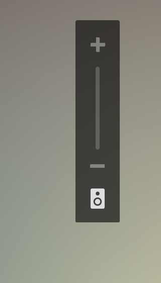
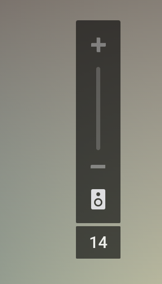

# ARC Volume

When a soundbar is connected over HDMI ARC, some Android TVs (for example TCL Google TVs) stop
showing the volume level. You press the volume button and only see `+` and `-` arrows, so you
have to guess how loud it is.

ARC Volume fixes that. Every time you change the volume, it shows the soundbar's current level
as a number right under the TV's own volume panel, and hides it together with the panel.

|                                   Without ARC Volume                                    |                                           With ARC Volume                                           |
| :-------------------------------------------------------------------------------------: | :-------------------------------------------------------------------------------------------------: |
|  |  |

## What it does

- Shows the soundbar's volume level as a number as soon as you press the remote.
- Shows a crossed-out speaker when the sound is muted.
- Fits the TCL Google TV volume panel out of the box; you can move the box and change its size
  for any other TV.
- Detects by itself how many levels your soundbar moves per press (for example 2 on a Sony
  HT-S350), so the number is right without any setup.
- Has no ads, no accounts, no internet access and no tracking. It is free and open source.

## Installation

ARC Volume needs Android 14 or newer. It was built and tested on a TCL 55C7K with a Sony HT-S350
soundbar.

1. Download `arc-volume-<version>.apk` from the
   [latest release](https://github.com/Domanell/android-tv-arc-volume/releases/latest).
2. Copy it to the TV and install it. For example:
    - put it on a USB stick and open it with a file manager app on the TV;
    - use an app such as **Downloader** or **Send Files to TV**.

    The TV asks you to allow installing apps from that source; allow it.

3. Open **ARC Volume** from the TV's app list.
4. A message asks you to allow **Display over other apps**. Select **Allow**. The TV opens a list
   of apps; find **ARC Volume** in it, press OK to turn it on, then press Back.
5. The app's screen now says **Running**. Press Back to close it. ARC Volume keeps working in the
   background.

Change the volume to see the number. To update later, install the new APK over the old one; your
settings are kept.

Some TVs, TCL among them, do not let apps start by themselves after a restart. Check this once in
[Starting with the TV](#starting-with-the-tv).

## Settings

Open **ARC Volume** from the app list.

- **Position and size:** select **Position** and move the box with the arrows (hold an arrow to
  move faster), then press OK. Use Left/Right on **Scale** to make it bigger or smaller.
  **Reset to default** puts it back under the TCL panel. While you are here, you can press the
  volume buttons to compare with the TV's own panel.
- **Volume step:** how many levels the soundbar moves per press. **Automatic step** is on by
  default. If the number is often wrong for a moment, select
  **Measure step now** and press Volume up three times, pausing after each press. You can also
  turn the automatic step off and set the number yourself.
- **Permissions and auto-start:** shows whether ARC Volume may display over other apps and
  whether it started by itself after the last TV restart.
- **Show preview:** shows the box for a moment, to check how it looks.

## Starting with the TV

If the number is missing after a TV restart, the TV did not start ARC Volume. To check, open
**ARC Volume > Permissions and auto-start** after a TV restart. If it says the app started by
itself, you are done. If not, the TV blocks apps from starting on their own. You can keep
opening the app once after each restart, or allow it to start by itself:

### TCL TVs: auto-start in TCL Guard

TCL TVs come with **TCL Guard** (also called Safety Guard), which decides which apps may start
with the TV.

1. In ARC Volume, open **Permissions and auto-start** and select **Auto-start**.
2. TCL Guard opens on **Permission Shield > Auto Launch**. Turn on **ARC Volume**.

Some TCL firmware hides the Auto Launch tab; ARC Volume tells you when that is the case. Then
allow auto-start with ADB, as described below. If TCL Guard is disabled on your TV, enable it in
**Settings > Apps** first.

### TCL TVs: auto-start with ADB

If TCL Guard has no Auto Launch tab, you can allow auto-start once from a computer with
[ADB](https://developer.android.com/tools/releases/platform-tools). The TV keeps this setting
after restarts.

1. On the TV, turn on developer options: open **Settings > System > About** and select
   **Android TV OS build** seven times.
2. Open **Settings > System > Developer options > Wireless debugging**, turn it on and choose
   **Pair device with pairing code**.
3. On the computer, run the three commands below with the values shown on the TV:
   - the pairing window shows the IP address with the **pairing port** and the **pairing code**;
   - the **Wireless debugging** screen itself shows the IP address with the **connect port**.
     The two ports are different.

    ```sh
    adb pair <tv-ip>:<pairing-port> <code>
    adb connect <tv-ip>:<connect-port>
    adb shell cmd appops set io.github.domanell.arcvolume AUTO_START allow
    ```

   For example, if the TV shows `192.168.0.14:37045` with code `482913` in the pairing window
   and `192.168.0.14:40103` on the Wireless debugging screen:

    ```sh
    adb pair 192.168.0.14:37045 482913
    adb connect 192.168.0.14:40103
    adb shell cmd appops set io.github.domanell.arcvolume AUTO_START allow
    ```

4. Restart the TV and check that the number appears without opening the app. You can turn
   wireless debugging off again.

To undo it, run the last command with `default` instead of `allow`, or uninstall the app.

## Troubleshooting

- **No number at all:** open ARC Volume. If it asks for **Display over other apps**, allow it.
  The screen should say **Running**.
- **The number is gone after a TV restart:** open ARC Volume once, or set up
  [Starting with the TV](#starting-with-the-tv).
- **The number disappears without a TV restart:** the TV stopped ARC Volume to free memory; open
  it once.
- **The number is wrong for a moment, then corrects itself:** this is normal for the first couple
  of single presses, while ARC Volume learns how far your soundbar moves per press. If it keeps
  happening, run **Volume step > Measure step now**.
- **The box is in the wrong place on your TV:** move it in **Position and size**.
- **The number lags when you press quickly many times:** the soundbar itself reports its level
  late during fast presses; the number always ends on the right level.
- **Nothing shows at volume 0 or at the maximum:** the level does not change there, so the TV
  reports nothing.

## How it works

The TV sends volume button presses to the soundbar over HDMI-CEC, and the soundbar reports its
level back. Android keeps that level, but in ARC "full volume" mode the TV's panel does not show
it. ARC Volume reads the level and draws it in a small overlay.

After a press, the TV first moves its own value by one, and the soundbar's real level arrives
about 300 ms later. ARC Volume learns how far the soundbar moves per press and shows the expected
level right away; the soundbar's report then confirms it.

## Building from source

Requirements: JDK 17+, Android SDK with `build-tools;34.0.0` and `platforms;android-34`, and
bash (Git Bash on Windows). No Gradle.

```sh
bash build.sh            # version from the VERSION file
bash build.sh 1.2.3      # explicit version
```

The APK is written to `build/arc-volume-<version>.apk` and signed with a local debug key. For a
release key, set `ARC_KEYSTORE`, `ARC_KEYSTORE_PASS` and optionally `ARC_KEY_ALIAS`.

Release APKs are signed with:

```
CN=Oleksandr Pavlii
SHA-256 7c:67:13:97:79:fe:57:1c:9c:1e:9b:90:7a:3d:05:32:6c:69:5d:81:42:34:80:67:34:87:10:d0:66:41:f8:bc
```

Logs: `adb logcat -s ArcVolume`. To log every volume event too, run
`adb shell setprop log.tag.ArcVolume DEBUG` first.

## License

MIT, see [LICENSE](LICENSE).
